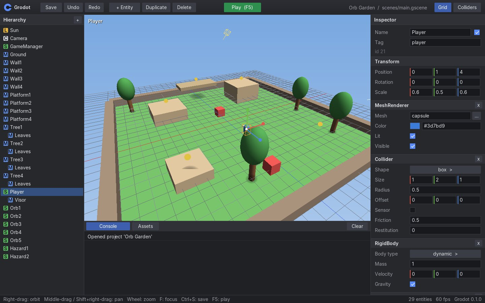

# Grodot

**A Linux-first 2D and 3D game engine with a scripting language you can learn in a day.**

Grodot is a small, coherent engine for game-jam sized 3D games: a graphical
editor, a runtime, simple physics, audio, and **Groscript**, a friendly
Ruby-inspired language. It is written in Rust with **zero third-party crates**:
it renders in software, talks to X11 and ALSA through `dlopen`, and builds with
nothing but `cargo`.



```ruby
# scripts/player.gro
class Player < Entity
  SPEED = 6

  function update(delta)
    direction = Vector3.new(Input.axis("move_left", "move_right"), 0,
                            Input.axis("move_forward", "move_back"))
    self.velocity = Vector3.new(direction.x * SPEED, self.velocity.y, direction.z * SPEED)

    if Input.just_pressed("jump") and self.on_floor?()
      self.velocity = self.velocity.with_y(7.5)
      Audio.play("assets/audio/jump.wav")
    end
  end

  function on_collision(other)
    if other.tag == "orb"
      print("Got one!")
    end
  end
end
```

## Quick start

You need a 64-bit Linux desktop (X11, or Wayland with XWayland) and the Rust
toolchain. No other development packages are required.

```sh
git clone https://github.com/evanxdsouza/grodot
cd grodot
cargo build --release
export PATH="$PWD/target/release:$PATH"

grodot new my-game          # create a project from the template
grodot open my-game         # open the editor; press Play (F5)
grodot run examples/orb-garden   # play the sample game
```

## What you get

| Part | What it does |
| --- | --- |
| **Editor** | Viewport with orbit camera and move gizmo, hierarchy with drag-to-parent, inspector for every component, asset browser, console, undo/redo, Play/Stop on an isolated copy of the scene. |
| **Groscript** | Dynamically typed, `end`-terminated blocks, classes with single inheritance, modules and imports, arrays, hashes, symbols, string interpolation, vectors and colours. Errors show the file, line, a caret and the call stack. |
| **Runtime** | Entity/component scenes, lifecycle callbacks (`ready`, `update`, `fixed_update`, `on_collision`, ...), timers, prefabs, scene loading, node paths, named groups, `queue_free()`, HUD text. Script errors disable one script, never the editor. |
| **Rendering** | Multithreaded software rasterizer: depth buffer, Gouraud lighting, fog, blob shadows, primitives and `.obj` meshes. Runs anywhere, including headless CI. |
| **2D** | `Camera2D` with zoom and world scale, colored/alpha-blended `Sprite2D` rectangles, transform hierarchy, rotation, and z ordering. See `examples/2d-starter`. |
| **Physics** | Fixed-step boxes and spheres: dynamic, kinematic and static bodies, sensors, collision enter/exit events, raycasts, `on_floor?()`. |
| **Audio** | WAV playback with a software mixer over ALSA (works on PipeWire and PulseAudio). Missing audio is a warning, not a crash. |
| **CLI** | `new`, `open`, `run`, `check`, `test`, `script`, `repl`, `package` (builds a `.tar.gz` you can hand to players). |

## Documentation

* **[Docs website](website/docs.html)**: getting started, the editor, the full
  Groscript reference, the engine API and the CLI.
* **[Learn Groscript in a day](website/docs.html#learn)**: eight one-hour lessons.
  Every example is tested by CI (`docs/examples`).
* [Language specification](docs/SPEC.md), [design decisions](docs/DECISIONS.md),
  [roadmap](ROADMAP.md), [contributing](CONTRIBUTING.md).

Open `website/index.html` in a browser for the landing page.

For a small editable 2D scene, run `grodot run examples/2d-starter` or open it
with `grodot open examples/2d-starter`. Texture-backed sprites and 2D physics
are planned separately.

## Repository layout

```
crates/
  groscript/        the language: lexer, parser, interpreter, built-ins
  grodot-core/      math, JSON, grodot.toml, scene/entity/component model, meshes
  grodot-render/    software rasterizer, canvas, fonts, scene rendering, picking
  grodot-platform/  X11 window + input, ALSA audio, WAV decoding (dlopen)
  grodot-runtime/   world, physics, script bindings, game loop
  grodot-editor/    editor UI, Play mode, standalone player
  grodot-cli/       the `grodot` executable
templates/default-project/   used by `grodot new`
examples/orb-garden/         the sample jam game
tests/language/              Groscript golden tests
docs/                        spec, decisions, tested tutorial examples
website/                     landing page and docs
```

## Testing

```sh
cargo test                                   # unit, golden, runtime and editor tests
cargo run -p grodot-cli -- test tests/language
cargo run -p grodot-cli -- run examples/orb-garden --headless --frames 600
```

The runtime and editor tests play the sample game headlessly: they drive the
player with simulated keys, collect orbs, touch hazards, win, and restart.

## Status

Version 0.1. Linux only (x86_64 tested). See [ROADMAP.md](ROADMAP.md) for what
is done and what is deliberately deferred (textures, glTF, gamepads, hot reload).

Grodot is an independent project. It is not affiliated with or endorsed by the
Godot Foundation.

## License

MIT, see [LICENSE](LICENSE). The bundled UI font data is rendered from Inter
(SIL Open Font License 1.1); see [docs/THIRD_PARTY.md](docs/THIRD_PARTY.md).
